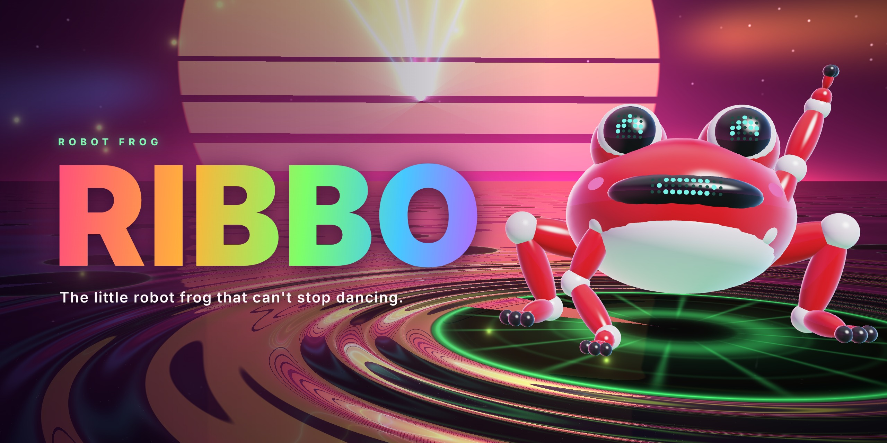
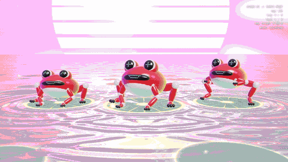
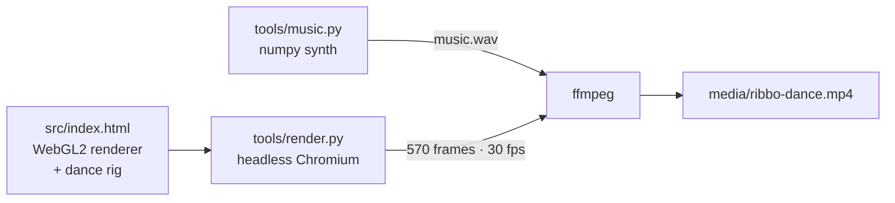
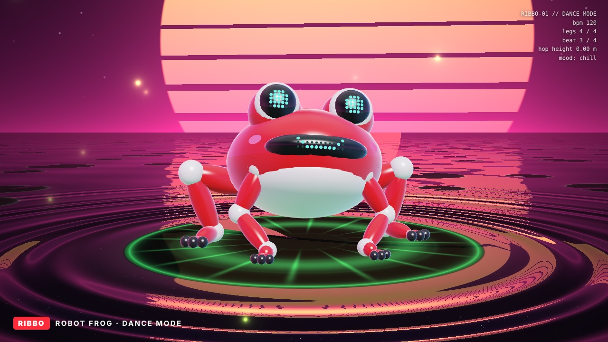
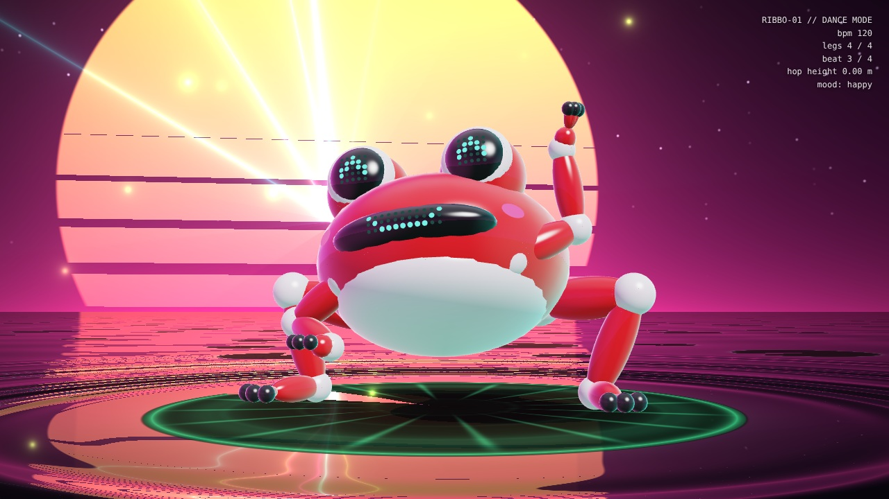
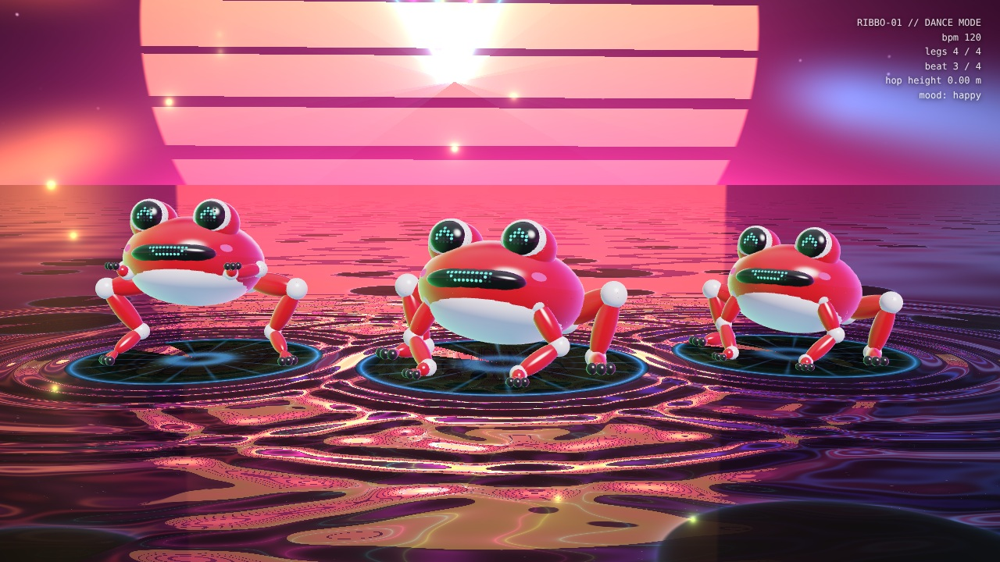

<p align="center">
  
</p>

<h1 align="center">RIBBO 🐸🤖</h1>

<p align="center">
  <b>The little robot frog that can't stop dancing.</b><br>
  Glossy red shell, LED-matrix face, four IK legs and one job: <i>hit every beat.</i>
</p>

<p align="center">
  
  
  
  
</p>

<p align="center">
  
</p>

<p align="center">
  ▶️ <b><a href="media/ribbo-dance.mp4">Watch the full 19-second video (with sound)</a></b>
</p>

---

## Meet RIBBO

RIBBO is a pocket-sized robot frog from the same toy-robot family as crab bots like
[Jumper](https://github.com/KingKongRobotics/jumper): a glossy red shell, white joint caps, a black chassis band and an
LED face that shows how it feels. Where Jumper walks sideways, RIBBO **hops**: knees out, hands up, landing on a neon
lily pad that ripples on every kick drum.

This repo has everything behind the video: the real-time WebGL2 renderer, the procedural dance rig, the
beat-synced choreography and the soundtrack, synthesised from scratch. No game engine, no 3D assets and no samples:
every pixel and every sound comes from code you can read.

## Highlights

- 🐸 **Procedural robot frog.** Body, eye domes, LED lenses, 4 limbs and 12 toes are built from analytic ellipsoids at runtime.
- 🦵 **2-bone IK legs.** Feet stay planted during squats, stretch out mid-jump and land again on the beat.
- 😀 **LED-matrix face.** Two 5×5 eye panels and an 11×3 mouth strip give it 6 eye moods and 5 mouth shapes (`chill`, `happy`, `star`, `charging > <`, `in love ♥`…).
- 🌅 **"Pond rave" stage.** A ray-traced water plane with ripples fired by the kick drum, a synthwave sun, sweeping lasers, fireflies, neon lily-pad dance floors and a rainbow sunburst for the drop.
- 🎶 **Beat-locked choreography.** 120 BPM, 9½ bars: groove → hands up → 360° hop-spin → charge → **drop with three frogs** → bye-bye wave.
- 🔊 **Synthesised soundtrack.** Kick, claps, hats, offbeat bass, pads, arp and riser, all made with numpy and side-chained to the kick.

## How it works



1. `src/index.html` exposes `renderAt(t)`, which poses every frog for time *t* (beat = `t × 2`), ray-marches the pond
   background in a full-screen shader and rasterises the robot on top.
2. `tools/render.py` drives headless Chromium through Playwright and screenshots the page frame by frame, so the
   output is deterministic.
3. `tools/music.py` builds the track on the same 120 BPM grid, so every bounce, ripple and laser pulse lands on the beat.
4. `ffmpeg` muxes everything into the final MP4.

## Quick start

```bash
git clone https://github.com/MyWestLord/ribbo.git
cd ribbo

# just look at it: open the renderer and scrub time from the dev console
open src/index.html            # then: renderAt(13.2)

# full pipeline: soundtrack → frames → video
pip install playwright numpy scipy && playwright install chromium
./scripts/build.sh             # writes media/ribbo-dance.mp4
```

## Project structure

```text
ribbo/
├── src/
│   └── index.html          # WebGL2 renderer, frog rig, IK, LED face, choreography, stage shader
├── tools/
│   ├── render.py           # deterministic frame capture (Playwright + headless Chromium)
│   └── music.py            # 120 BPM soundtrack synthesiser (numpy / scipy)
├── scripts/
│   └── build.sh            # one-shot pipeline: music → frames → mp4
├── media/
│   └── ribbo-dance.mp4     # the final video (1280×720, 30 fps, 19 s)
├── assets/
│   ├── ribbo-banner.jpg
│   ├── preview.gif
│   └── stills/             # key frames from each section
└── docs/
    ├── DESIGN.md           # anatomy, palette, LED expressions, proposed hardware spec
    └── CHOREOGRAPHY.md     # bar-by-bar dance timeline
```

## Gallery

| Night pond | Lasers on | The drop |
|:---:|:---:|:---:|
|  |  |  |

## Docs

- 🧩 [**Design**](docs/DESIGN.md): anatomy, colour palette, LED expression sheet and the proposed physical build
- 💃 [**Choreography**](docs/CHOREOGRAPHY.md): the full bar-by-bar timeline of the dance

## Roadmap

- [ ] Physical prototype: servo legs (10 DOF), ESP32 brain, 8×8 LED eye matrices
- [ ] Live audio-reactive mode (microphone → beat tracking → dance)
- [ ] More dances and a choreography editor
- [ ] Vertical 9:16 export for Reels / TikTok / Shorts

## Credits

Inspired by the wonderful open-source crab robot [**Jumper**](https://github.com/KingKongRobotics/jumper) by
KingKongRobotics. RIBBO is an independent fan project and is not affiliated with them.

## License

[MIT](LICENSE). Fork it, remix it, make it dance.
